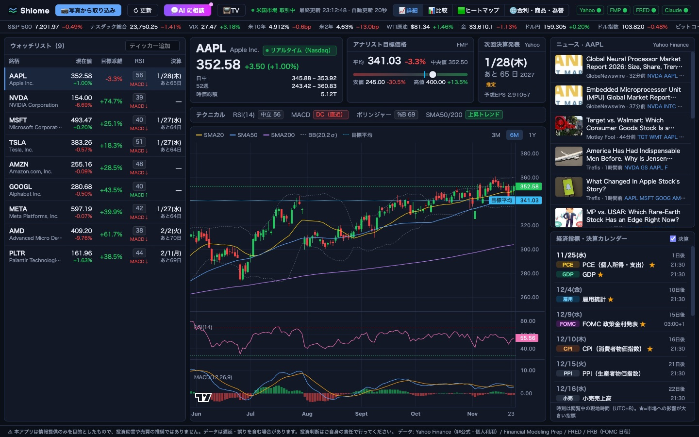
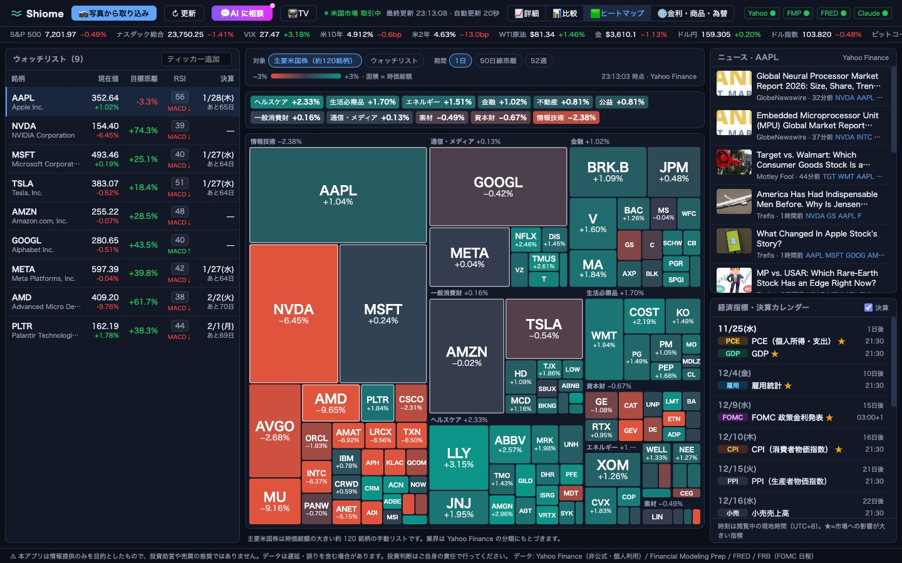
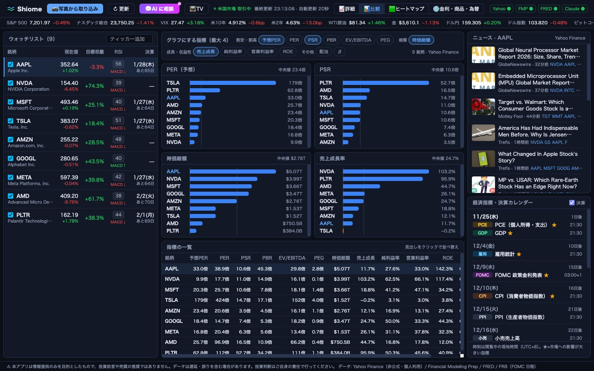
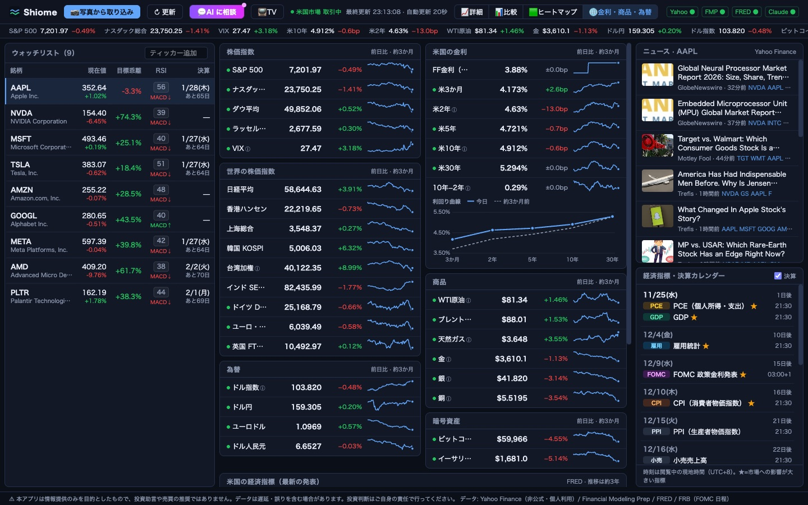
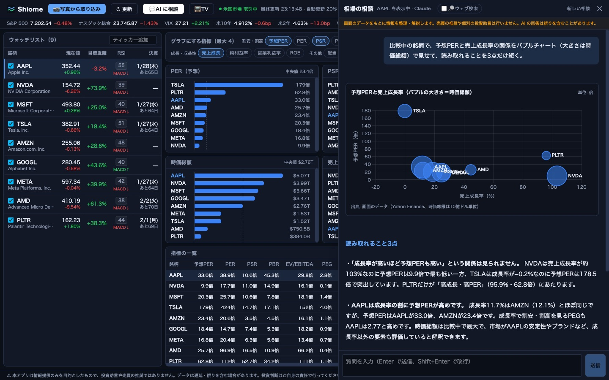

<p align="center">
  <picture>
    <source media="(prefers-color-scheme: dark)" srcset="brand/shiome-logo-dark.png">
    
  </picture>
</p>

<p align="center">
  A one-screen US stock dashboard: watchlist, analyst targets, technicals, earnings, a sector heatmap, rates / commodities / FX, the economic calendar, news, live business TV and an AI explainer that can search the web and draw charts.<br>
  米国株のウォッチリストを、目標価格・テクニカル・決算日・業界ヒートマップ・金利/商品/為替・経済指標・ニュース・経済ニュースのライブ TV と一緒に 1 画面で。ウェブ検索や図で答える AI 相談付き。
</p>

<p align="center"><a href="#日本語">日本語</a> · <a href="#english">English</a></p>



| Sector heatmap | Compare valuations |
| --- | --- |
|  |  |
| **Rates, commodities, FX, world indices, US indicators** | **AI chat with charts** |
|  |  |

> [!WARNING]
> **For information only. Not investment advice.** Prices can be delayed or wrong. Shiome does not recommend buying or selling anything.
> 情報提供のみを目的としたツールです。投資助言や売買の推奨ではありません。

---

## English

*Shiome* (潮目) is the line where two ocean currents meet — the place where the tide turns. The app helps you notice when the market's current changes.

### Features

- **Import tickers from a photo** — drop a screenshot of your brokerage app or watchlist. Tickers are read by Claude (if `ANTHROPIC_API_KEY` is set) or by Tesseract.js in the browser, then you review and fix them before adding.
- **Compare your watchlist** — price, change, upside to the analyst mean target, RSI and MACD direction, and days until earnings. Sort by any column.
- **One-screen detail view**
  - Real-time / delayed price (labelled), pre-market and after-hours price
  - Analyst targets: mean, median, high, low and the gap to the current price
  - Candlestick chart with SMA 20/50/200, Bollinger Bands, RSI and MACD
  - Badges for overbought/oversold RSI, MACD crosses, Bollinger position and trend
  - Next earnings date
- **Compare stocks** — pick stocks and compare up to four metrics as bar charts (forward / trailing P/E, P/S, P/B, EV/EBITDA, PEG, market cap, revenue growth, margins, ROE, dividend yield, beta), with a median line and a sortable table.
- **Sector heatmap** — about 120 large US stocks (or your watchlist) grouped by sector, sized by market cap and colored by 1-day, 50-day-average or 52-week change.
- **Rates, commodities, FX** — a market strip under the header, plus a view with US indices and VIX, world indices, Treasury yields with a yield curve, oil, gold, copper, the dollar, FX pairs and crypto (3-month sparklines), and the latest US economic releases (CPI, PCE, jobs, GDP, …) from FRED.
- **Economic calendar** — CPI, jobs report, PCE, GDP, PPI, retail sales (from FRED) and FOMC decisions, shown in your local time together with your watchlist's earnings dates.
- **News** for the selected stock.
- **Live business TV** — a draggable mini player that expands to a large view: Bloomberg Television, Yahoo Finance, NHK WORLD-JAPAN, Sky News and DW News (official YouTube live streams).
- **Ask AI about the screen** — Claude explains what you are looking at, searches the web with **Exa and Tavily** together when it needs fresh information (with sources), and answers with **charts** (Chart.js: bar, line, area, doughnut, radar, scatter, bubble; three.js: rotatable 3D scatter) and tables. It is instructed never to give buy/sell recommendations, price targets or personal advice.
- **Auto refresh** — every 20 seconds while the US market (including pre/post) is open, every 5 minutes otherwise.

### Quick start

```bash
npm install
cp .env.example .env      # add your own keys (all optional)
npm run dev               # API on :8787, web on :5180
```

Open <http://localhost:5180>. With no keys at all, Shiome still works using Yahoo Finance data.

| Variable | Used for | Without it |
| --- | --- | --- |
| `FMP_API_KEY` | [Financial Modeling Prep](https://site.financialmodelingprep.com/developer/docs): daily prices, analyst targets, earnings dates, ticker validation | Yahoo Finance is used |
| `FRED_API_KEY` | [FRED](https://fred.stlouisfed.org/docs/api/api_key.html): release dates of economic indicators | Only FOMC dates are shown |
| `ANTHROPIC_API_KEY` | [Claude](https://console.anthropic.com): reading tickers from images, the chat panel | Tesseract.js OCR; chat is off |
| `EXA_API_KEY` | [Exa](https://exa.ai): web search in the chat | Search uses Tavily only (or is off) |
| `TAVILY_API_KEY` | [Tavily](https://tavily.com): web search in the chat | Search uses Exa only (or is off) |

Keys are read only by the server and never sent to the browser. `DEMO=1` shows made-up demo data without any network calls.

### Deploy to Cloudflare Workers

The web app is served as static assets and the API runs in the same Worker. **The API only answers requests that passed [Cloudflare Access](https://developers.cloudflare.com/cloudflare-one/policies/access/)**; until Access is configured it returns an error, so your keys are never exposed.

```bash
npx wrangler login
npm run deploy                          # creates the KV namespace on first deploy
npx wrangler secret put FMP_API_KEY     # repeat for FRED_API_KEY / ANTHROPIC_API_KEY / EXA_API_KEY / TAVILY_API_KEY
```

Then, in the Cloudflare dashboard:

1. Workers & Pages → your Worker → **Access** → protect **all traffic** (production and previews).
2. Zero Trust → Access → Applications → your app → **Policies**: allow a list of **Emails**. **Login methods**: enable **One-time PIN** (users get a code by email; no Cloudflare account needed).
3. Copy the **AUD tag** and the **team domain** (`https://<team>.cloudflareaccess.com`), put them in `vars` of `wrangler.local.jsonc` (a git-ignored copy of `wrangler.jsonc` for your own account, used automatically by `npm run deploy`), and deploy again.

### Data sources and refresh

| Data | Source (first wins) | Refresh |
| --- | --- | --- |
| Current price, change, extended hours | Yahoo → FMP | 20 s while the market is open, otherwise 5 min |
| Daily candles | FMP → Yahoo | 6 h cache; today's candle follows the live price |
| Analyst targets, next earnings | FMP → Yahoo | 12 h cache |
| News | Yahoo | 5 min |
| Economic calendar | FRED + FOMC schedule in `server/econ.ts` | 12 h cache |

Yahoo Finance data is fetched with the unofficial [`yahoo-finance2`](https://github.com/gadicc/yahoo-finance2) library. It may break without notice, and Yahoo's terms limit it to personal use — do not use Shiome to redistribute Yahoo data or run it as a public service.

### Project layout

```
server/   API (Hono). app.ts = routes; node.ts = local entry; worker.ts = Cloudflare entry
          fmp.ts / yahoo.ts / econ.ts = data sources, chat.ts = Claude chat, access.ts = Access JWT check
src/      React + Tailwind UI. lib/indicators.ts = SMA / RSI / MACD / Bollinger Bands
brand/    Logo files
```

The FOMC schedule in `server/econ.ts` is maintained by hand — update it when the Federal Reserve publishes or changes its calendar.

---

## 日本語

**潮目**は、性質の違う 2 つの潮の流れがぶつかる境目のことです。相場の流れが変わる瞬間に気づくための道具、という意味を込めています。

### できること

- **写真から銘柄を取り込む** — 証券アプリやウォッチリストのスクリーンショットから、ティッカーを読み取ります（Claude またはブラウザ内 OCR）。追加する前に確認・修正できます。
- **ウォッチリストの比較** — 現在値・前日比・目標価格との乖離率・RSI・MACD の向き・決算までの日数を一覧で。列ごとに並べ替えできます。
- **1 画面の詳細** — リアルタイム／遅延の表示付きの現在値とプレ・アフターマーケットの価格、アナリスト目標価格（平均・中央値・高値・安値）、ローソク足チャート（SMA 20/50/200・ボリンジャーバンド・RSI・MACD）、テクニカルのバッジ、次回決算日。
- **銘柄の比較** — 選んだ銘柄を、予想・実績 PER、PSR、PBR、EV/EBITDA、PEG、時価総額、売上成長率、利益率、ROE、配当利回り、ベータのうち最大 4 つの棒グラフで比較。中央値の線と並べ替えできる表付き。
- **業界別ヒートマップ** — 主要米国株（約 120 銘柄）またはウォッチリストを業界ごとにまとめ、面積は時価総額、色は 1 日・50 日線乖離・52 週の変化率。
- **金利・商品・為替** — ヘッダー下の市場の要約バーと、米国・世界の株価指数、VIX、米国債利回りと利回り曲線、原油・金・銅、ドル・主要通貨、暗号資産（約 3 か月の推移付き）、FRED による米国経済指標の最新値（CPI、PCE、雇用、GDP など）。
- **経済指標カレンダー** — CPI・雇用統計・PCE・GDP・PPI・小売売上高（FRED）と FOMC を、閲覧している場所の時刻で表示。ウォッチリストの決算日もまとめて並べます。
- **ニュース** — 選んだ銘柄の最新ニュース。
- **経済ニュースのライブ TV** — 小窓（ドラッグで移動）と拡大を切り替えられるプレーヤー。Bloomberg Television、Yahoo Finance、NHK WORLD-JAPAN、Sky News、DW News（YouTube の公式ライブ）。
- **AI に相談** — 表示中のデータを Claude が解説。最新情報が必要なときは **Exa と Tavily を同時に**使ってウェブ検索し、出典付きで答えます。**図**（Chart.js の棒・折れ線・面・ドーナツ・レーダー・散布図・バブル、three.js の回せる 3D 散布図）や表でも示します。売買の推奨や個別の投資助言はしないよう指示しています。
- **自動更新** — 米国市場の取引時間中（プレ・アフター含む）は 20 秒ごと、それ以外は 5 分ごと。

### はじめ方

```bash
npm install
cp .env.example .env      # キーを自分で記入（すべて任意）
npm run dev               # API（:8787）と画面（:5180）を起動
```

<http://localhost:5180> を開きます。キーがなくても Yahoo Finance のデータで動きます。キーの用途は上の表（English）のとおりです。キーはサーバー側だけで使い、ブラウザには送りません。

### Cloudflare Workers へのデプロイ

画面と API を 1 つの Worker で動かします。**API は Cloudflare Access でログインした人にしか応答しません**（Access を設定するまではエラーを返すので、キーが外に出ることはありません）。

```bash
npx wrangler login
npm run deploy                          # 初回は KV が自動で作られます
npx wrangler secret put FMP_API_KEY     # FRED_API_KEY / ANTHROPIC_API_KEY も同様
```

そのあと Cloudflare のダッシュボードで:

1. Workers & Pages → Worker → **Access** で、すべてのトラフィック（本番とプレビュー）を保護する
2. Zero Trust → Access → Applications → アプリ → **Policies** で、許可する **Emails** を並べる。**Login methods** は **One-time PIN**（メールに届くコードでログイン。Cloudflare アカウントは不要）
3. **AUD タグ**と **Team domain**（`https://〇〇.cloudflareaccess.com`）を、`wrangler.local.jsonc`（自分のアカウント用に `wrangler.jsonc` をコピーしたファイル。git には含めず、`npm run deploy` が自動で使う）の `vars` に入れて再デプロイ

### 注意

- Yahoo Finance のデータは非公式ライブラリ `yahoo-finance2` で取得しています。仕様変更で突然取れなくなることがあります。Yahoo の規約上、**個人利用に限り**、データの再配布や公開サービスでの利用はしないでください。
- FOMC の日程は `server/econ.ts` に手で書いています。FRB が日程を公表・変更したら更新してください。

## License

[MIT](LICENSE) © 2026 ENGINEERNEST
